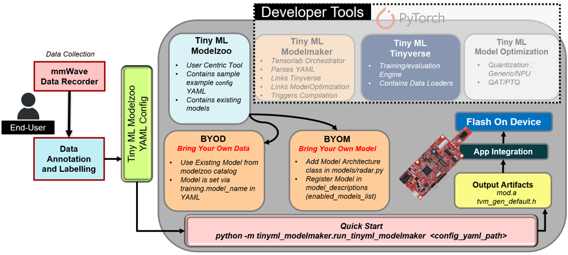

# Radar Posture & Fall Detection 
#### -Atharv Vats, Adithya Thonse

Classify a person's posture (standing, sitting, walking, falling, laying) from a TI mmWave radar sensor, using the point cloud + track outputs the radar's on-device signal chain already produces — no raw ADC data feature extraction support within Tensorlab today.

This guide covers the data pre-processing configuration, training, quantization, and compilation for the xWRL6432 target using Tensorlab EdgeAI - Tiny ML Modelzoo Framework for retraining purposes.

Modelzoo provides a modular CLI approach to add new models/ modify existing model architectures, providing BYOD, BYOM approach from re-training perspective.

- **Example config:** [config.yaml](./config.yaml)
- **Sample Dataset:** [posture_and_fall_detection_dataset.zip](https://software-dl.ti.com/C2000/esd/mcu_ai/datasets/posture_and_fall_detection_dataset.zip)

---

## Index

- [Overview](#overview)
- [Quick Start](#quick-start)
  - [Prerequisites Checklist](#prerequisites-checklist)
  - [Linux / macOS — Install](#linux--macos--install)
  - [Windows (PowerShell) — Install](#windows-powershell--install)
  - [Quick Commands (After Install)](#quick-commands-after-install)
  - [Bring Your Own Data (BYOD) / Bring Your Own Model (BYOM)](#bring-your-own-data-byod--bring-your-own-model-byom)
  - [Output Structure](#output-structure)
  - [Data Collection Procedure (for Custom Data)](#data-collection-procedure-for-custom-data)
- [YAML Configuration for Posture & Fall Detection](#yaml-configuration-for-posture--fall-detection)
  - [Identify Your Data Source](#identify-your-data-source)
  - [Expected Column Names (Case-Sensitive)](#expected-column-names-case-sensitive)
  - [Dataset Split Methods](#dataset-split-methods)
  - [Data Pre Processing and Feature Extraction Presets](#data-pre-processing-and-feature-extraction-presets)
  - [`data_processing_feature_extraction` YAML block generation](#data_processing_feature_extraction-yaml-block-generation)
- [Output Tensor](#output-tensor)
- [Quantization](#quantization)
- [Compilation](#compilation)
- [Key Reference Files](#key-reference-files)
- [Need More Help?](#need-more-help)

---

## Overview

This example config demonstrates retraining through Tensorlab and final compiled artifacts generation for using TI mmWave sensors with machine learning for human posture and fall classification using the xWRL6432 sensor module. The application classifies five pose states:

- **Falling** (class 0)
- **Laying** (class 1)
- **Sitting** (class 2)
- **Standing** (class 3)
- **Walking** (class 4)

The model uses the radar's on-device signal chain outputs — point cloud detections and track data — as input. Refer to the Radar Toolbox for procedures to flash, run, and customize the xWRL6432 sensor module for pose and fall detection. 

### Retraining Workflow



---

## Quick Start

### Prerequisites Checklist

| Requirement | Version | Notes |
|-------------|---------|-------|
| Python | 3.10.x | **Required** for ti_mcu_nnc compiler wheel |
| Git | Latest | With core.longpaths=true |
| Virtualenv | Built-in | python -m venv |
| TI ARM Compiler | 5.1.1.LTS | For compilation only; set TI_CGT_ARMLLVM_PATH |
| CUDA (optional) | 11.8+ | For GPU training; CPU works fine |

---

### Linux / macOS — Install 

```bash
# 1. Enable long paths (required for some model files)
git config --global core.longpaths true

# 2. Clone and enter repo
git clone https://github.com/TexasInstruments/tinyml-modelzoo.git
cd tinyml-modelzoo

# 3. Create virtual environment & install (pulls modelmaker, tinyverse, torchmodelopt, ti_mcu_nnc as wheels)
python3.10 -m venv venv
source venv/bin/activate
python -m pip install --upgrade pip setuptools wheel
pip install -e .

# 4. Verify installation
python -c "import tinyml_modelmaker, tinyml_tinyverse, tinyml_torchmodelopt, tinyml_modelzoo; print('All packages OK')"

# 5. Set compiler for xWRL6432 (required for compilation step)
export TI_CGT_ARMLLVM_PATH=/path/to/ti-cgt-armllvm_5.1.1.LTS  # Adjust path

# 6. Run training (outputs to ./data/projects/)
./run_tinyml_modelzoo.sh examples/radar_posture_and_fall_detection/config.yaml
```

---

### Windows (PowerShell) — Install

```powershell
# 1. Enable long paths (run once as Administrator)
git config --global core.longpaths true

# 2. Clone and enter repo
git clone https://github.com/TexasInstruments/tinyml-modelzoo.git
cd tinyml-modelzoo

# 3. Create virtual environment & install
python -m venv venv
.\venv\Scripts\Activate.ps1
python -m pip install --upgrade pip setuptools wheel
pip install -e .

# 4. Verify installation
python -c "import tinyml_modelmaker, tinyml_tinyverse, tinyml_torchmodelopt, tinyml_modelzoo; print('All packages OK')"

# 5. Set compiler for xWRL6432 (required for compilation step)
#$env:TI_CGT_ARMLLVM_PATH = "C:\path\to\ti-cgt-armllvm_5.1.1.LTS"  # Adjust path

# 6. Run training (outputs to .\data\projects\)
# If script blocked: Set-ExecutionPolicy -ExecutionPolicy RemoteSigned -Scope CurrentUser
./run_tinyml_modelzoo.ps1 examples/radar_posture_and_fall_detection/config.yaml
```

---

### Quick Commands (After Install)

| Action | Linux/macOS | Windows (PowerShell) |
|--------|-------------|----------------------|
| **Activate venv** | source venv/bin/activate | .\venv\Scripts\Activate.ps1 |
| **Run training** | ./run_tinyml_modelzoo.sh examples/radar_posture_and_fall_detection/config.yaml | ./run_tinyml_modelzoo.ps1 examples/radar_posture_and_fall_detection/config.yaml |


---

### Bring Your Own Data (BYOD) / Bring Your Own Model (BYOM)

#### **BYOD: Use Your Own Radar Data**

1. **Organize data by class** (required for split):
   ```
   my_dataset/
   ├── classes/
   │   ├── falling/
   │   │   ├── fall_001.csv
   │   │   └── fall_002.csv
   │   ├── sitting/
   │   │   ├── sit_001.csv
   │   │   └── ...
   │   └── standing/
   │       └── ...
   ```

2. **Update config.yaml** — point to your data:
   ```yaml
   dataset:
     dataset_name: "my_custom_posture"
     input_data_path: ""  # Empty = no auto-download
     split_type: "amongst_files"  # or "within_files" for long recordings
     split_factor: [0.7, 0.2, 0.1]
   ```

3. **Ensure column names match** (see [Expected Column Names](#expected-column-names-case-sensitive)) to map your columns in case you want to use the Complete Data Pre Processing Pipeline integrated with Tensorlab.

4. **Run training**:
   ```bash
   ./run_tinyml_modelzoo.sh examples/radar_posture_and_fall_detection/config.yaml
   ```

#### **BYOM: Add Your Own Model**

1. **Edit** `tinyml_modelzoo/models/radar.py` and add your model class:
   ```python
   class MyCustomRadarModel(nn.Module):
       def __init__(self, config, input_features=248, variables=1, num_classes=5):
           super().__init__()
           self.config = config or {}
           self.input_features = self.config.get('input_features', input_features)
           self.variables = self.config.get('variables', variables)
           self.num_classes = self.config.get('num_classes', num_classes)
           
           input_size = self.input_features * self.variables
           
           # Your architecture here
           self.layers = nn.Sequential(
               nn.BatchNorm1d(input_size),
               nn.Linear(input_size, 128),
               nn.ReLU(),
               nn.BatchNorm1d(128),
               nn.Linear(128, num_classes)
           )
       
       def forward(self, x):
           x = x.view(x.size(0), -1)
           return self.layers(x)
   
   # Add to __all__ list at bottom of file:
   __all__ = [
       'RF_MLP_3L_11K', 'RF_MLP_4L_19K', 'RF_DualStream_PointCloud_19K',
       'MyCustomRadarModel'  # <-- Add here
   ]
   ```

2. **Register model metadata** in `tinyml_modelzoo/model_descriptions/classification.py`:
   - Add a new entry in the `_model_descriptions` dictionary 
   - Add the model key to `enabled_models_list` 
   
   ```python
   # In _model_descriptions dict (around line 1576):
   'MyCustomRadarModel': deep_update_dict(deepcopy(template_model_description), {
       'common': dict(
           generic_model=False,
           task_type=constants.TASK_TYPE_RADAR_POINT_CLOUD_CLASSIFICATION,  # or RADAR_SURFACE_CLASSIFICATION
           task_category=constants.TASK_CATEGORY_RADAR_CLASSIFICATION,
           model_details='Custom radar model for posture detection'
       ),
       'training': dict(
           model_training_id='MyCustomRadarModel',  # Must match class name in radar.py!
           model_name='MyCustomRadarModel',
           quantization=TinyMLQuantizationVersion.QUANTIZATION_GENERIC,
           properties=[dict(type="group", dynamic=True, script="radarclassification.py",
                          name="preprocessing_group", label="Preprocessing Parameters", default=[])] + template_gui_model_properties,
           target_devices=[
               constants.TARGET_DEVICE_xWRL6432,
           ],
       ),
   }),
   
   # In enabled_models_list (line 1606), add:
   enabled_models_list = [
       ...
       'RF_MLP_3L_11K', 'RF_MLP_4L_19K', 'RF_DualStream_PointCloud_19K',
       'MyCustomRadarModel',  # <-- Add here
   ]
   ```

3. **Use in config**:
   ```yaml
   training:
     model_name: "MyCustomRadarModel"
   ```

4. **Reinstall** :
   ```bash
   pip install -e .
   ```

> **Developer install** (pip install -e .) picks up model changes instantly — no rebuild needed.

> **Note**: Model descriptions are Python dicts in classification.py. See existing radar entries (RF_MLP_3L_11K, RF_MLP_4L_19K, RF_DualStream_PointCloud_19K) as templates.

---

### Output Structure

After training completes, find artifacts at:

```
./data/projects/radar_point_cloud_classification/run/<RUN_ID>/
├── training/
│   ├── base/           # Float model (ONNX, checkpoint.pth)
│   └── quantization/   # Quantized model (ONNX, checkpoint.pth)
└── compilation/
    └── artifacts/      # C artifacts: tvmgen_default.h, mod.a
```

---

### Data Collection Procedure (for Custom Data)

1. Configure mmWave Data Recorder with appropriate `.cfg` file
2. Use hotkey-triggered recording to capture only desired motion segments:
   - Press hotkey → start recording
   - Perform pose/motion
   - Press hotkey → stop recording
3. Save each class to separate subdirectory

Refer to the [Radar Toolbox mmWave Data Recorder User Guide](http://dev.ti.com/tirex/local?id=mmWave_Data_Recorder_User_Guide&packageId=radar_toolbox) for detailed instructions

#### Converting mmWave Data Recorder Captures to Tensorlab Expected CSV Format

If your data comes straight out of the mmWave Data Recorder, use [annotate_radar_dataset.py](./annotate_radar_dataset.py) to convert it into a ready-to-use dataset ZIP.

**Input Directory Structure** 
>**Important Modification needed in binData Folder from User's end** : To develop 'class label' named folders (eg. falling, walking etc.) and classify the session folders in binData accordingly.

```
binData/
├── falling/
│   ├── session_001/
│   │   ├── replay_1234567890.csv
│   │   ├── replay_1234567890.json
│   │   └── pHistBytes_1234567890_.bin
│   ├── session_002/
│   │   ├── replay_1234567891.csv
│   │   └── replay_1234567891.json
│   └── ...
├── sitting/
│   ├── session_003/
│   │   ├── replay_1234567892.csv
│   │   └── replay_1234567892.json
│   └── ...
├── standing/
├── walking/
└── laying/
```

**Run the Conversion Script**:

```bash
python annotate_radar_dataset.py --input /path/to/binData --output /path/to/my_radar_dataset.zip
```

**Output ZIP Structure** (ready for Tensorlab):

```
my_radar_dataset.zip
└── classes/
    ├── falling/
    │   ├── session_001.csv
    │   ├── session_002.csv
    │   └── ...
    ├── sitting/
    │   ├── session_003.csv
    │   └── ...
    ├── standing/
    ├── walking/
    └── laying/
```


**Update config.yaml** to point at the ZIP:

```yaml
dataset:
  input_data_path: /path/to/my_radar_dataset.zip
```


---

## YAML Configuration for Posture & Fall Detection

### Identify Your Data Source

| Case | Description | Action |
|------|-------------|--------|
| **A** | Data from TI Data Recorder / Visualizer (standard columns: point_x*, track_id, track_velocity_*) | Use Generic_248Input_Posture_and_Fall_Detection preset directly |
| **B** | Pre-cleaned / externally featurized data (no point_*, track_*, bin* columns) - Ready to pass to Model for Training | Use Generic_Radar_SimpleWindowOnly preset |

---

> **Radar Config Builder (Coming Soon)**
>
> In the next Tensorlab release, we will be having a Radar config builder tool to help in streamlined yaml generation.

### Expected Column Names (Case-Sensitive)

If your data uses different column names (Case B above), rename to Tensorlab's expected format:

| Data Type | Column Pattern | Example Columns |
|-----------|----------------|-----------------|
| **Range Data** | `bin0`, `bin1`, `bin2`... `binN` | `bin0` through `bin63` (FFT range profile) |
| **Point Cloud** | `point_x{idx}`, `point_y{idx}`, `point_z{idx}`, `point_doppler{idx}`, `point_snr{idx}` | `point_x0`, `point_y0`, `point_z0`, `point_doppler0`, `point_snr0`, `point_x1`... |
| **Track Data** | `track_id` or `tid` | Required for ghost track filtering |
| | `track_x`, `track_y`, `track_z` | Track position |
| | `track_velocity_x`, `track_velocity_y`, `track_velocity_z` | Track velocity |
| | `track_acc_x`, `track_acc_y`, `track_acc_z` | Track acceleration |

### Dataset Split Methods

| `split_type` | When to Use |
|--------------|-------------|
| `within_files` | Single long recording |
| `amongst_files` | Each recording session = one posture class (recommended with sufficient dataset). | 

### Data Pre Processing and Feature Extraction Presets

```yaml
data_processing_feature_extraction:
  feature_extraction_name: "Generic_248Input_Posture_and_Fall_Detection"
```

**What this preset configures:**

| Pipeline Stage | Parameter | Value | Purpose |
|----------------|-----------|-------|---------|
| **Point Cloud Data** | `radar_point_cloud_data_selector` | `['y', 'z', 'snr']` | Keep: distance (y), height (z), SNR |
| | `radar_point_cloud_coordinate_system` | `'relative'` | Make coords relative to track |
| | `radar_point_cloud_relative_coordinate_filter` | `['y']` | Only make **distance (y)** relative to track centroid |
| | `radar_point_cloud_spatial_filter_bounds` | `[None, None, -10, 10, -10, 10]` | Filter y,z (height): ±10m; x unbounded|
| | `radar_point_cloud_non_spatial_filter_bounds` | `[None, None, None, None]` | No Doppler/SNR filtering |
| | `radar_max_points_per_frame` | `8` | Keep top 8 points per frame |
| | `radar_point_cloud_structure_strategy` | `'highest and lowest'` | Select highest & lowest points by sort key |
| | `radar_point_cloud_sort_by` | `'z'` | Sort by **height (z)** before selection |
| **Track Data** | `radar_track_data_selector` | `['z', 'velocity', 'acceleration']` | Keep: height, velocity, acceleration |
| | `radar_track_velocity_bounds` | `[-10, 10]` | Filter velocity: ±10 |
| | `radar_track_acceleration_bounds` | `[-10, 10]` | Filter acceleration: ±10 |
| | `radar_track_spatial_filter_bounds` | `[None, None, None, None, -10, 10]` | Filter track z (height): ±10m |
| **Windowing** | `frame_size` | `8` | 8 consecutive radar frames = 1 sample |
| | `stride_size` | `0.125` | 1-frame overlap (8 × 0.125 = 1) |
| | `radar_min_points_per_window` | `12` | Min 12 real points across 8 frames |
| | `radar_frames_quality_index` | `'per_window'` | Quality check at window level |
| | `radar_feature_ordering` | `'frame_major'` | Flatten: frame0_feat0, frame0_feat1... |

**Output Calculation:**
```
Point Cloud: 3 features × 8 points × 8 frames = 192 features
Track:       7 features (z + vel_x,y,z + acc_x,y,z) × 8 frames = 56 features
Total:       192 + 56 = 248 features → matches RF_DualStream_PointCloud_19K
```

> **Important: Sensor Mounting Configuration**  
> The preset assumes standard mounting with:
> - `y` = distance (range to target)
> - `z` = elevation (height/vertical)
>
> **Depending on your sensor's physical orientation, you MUST override the coordinate mapping:**
>
> **Example 1: Standard Mounting (default)**
> - Distance: `y`, Elevation: `z`
> - No override needed (preset handles this)
>
> **Example 2: Sensor Rotated 90°**
> - When rotated 90° around the horizontal axis:
>   - `y` remains distance (range to target)
>   - **`x` becomes elevation (height)** — was previously unused
> - Override:
> ```yaml
> radar_point_cloud_data_selector: ['x', 'y', 'snr']  # Use x (height) instead of z
> radar_point_cloud_relative_coordinate_filter: ['y']  # Make y (distance) relative
> radar_point_cloud_sort_by: 'x'  # Sort by elevation (x now = height)
> ```
>
> **General Rule**: Identify which physical axis is **distance (range to target)** and which is **elevation (vertical/height)**, then map those to the appropriate parameters in the YAML.
---

### `data_processing_feature_extraction` YAML block generation

#### Option 1: Override Preset Parameters

```yaml
data_processing_feature_extraction:
  feature_extraction_name: "Generic_248Input_Posture_and_Fall_Detection"
  
  # --- Common Overrides ---
  frame_size: 16                    # More temporal context (default: 8)
  stride_size: 0.5                  # Less overlap, faster training (default: 0.125)
  radar_min_points_per_window: 20   # Stricter quality (default: 12)
  radar_max_points_per_frame: 12    # More points per frame (default: 8)
  
  # --- Point Cloud Overrides ---
  radar_point_cloud_data_selector: ['x', 'y', 'z', 'snr']  # Add x (azimuth)
  radar_point_cloud_sort_by: 'y'    # Sort by distance instead of height
  
  # --- Quality Mode Override ---
  # radar_frames_quality_index: 'per_radar_frame'  # Per-frame instead of per-window
  # radar_min_points_per_frame: 3                  # Min points per frame
  
  # --- Disable Quality ---
  # radar_frames_quality_index: None
```


---

#### Option 2: Fully Inline (No Preset)

```yaml
data_processing_feature_extraction:
  data_proc_transforms:
    - "Radar Point Cloud Data"
    - "Radar Track Data"
    - "Simple Window"
  
  # Window parameters
  frame_size: 8
  stride_size: 0.125
  
  # Point Cloud
  radar_point_cloud_data_selector: ['y', 'z', 'snr']
  radar_point_cloud_coordinate_system: 'relative'
  radar_point_cloud_relative_coordinate_filter: ['y']
  radar_point_cloud_spatial_filter_bounds: [None, None, -10.0, 10.0, -10.0, 10.0]
  radar_point_cloud_non_spatial_filter_bounds: [None, None, None, None]
  radar_max_points_per_frame: 8
  radar_point_cloud_structure_strategy: 'highest and lowest'
  radar_point_cloud_sort_by: 'z'
  
  # Track
  radar_track_data_selector: ['z', 'velocity', 'acceleration']
  radar_track_velocity_bounds: [-10.0, 10.0]
  radar_track_acceleration_bounds: [-10.0, 10.0]
  radar_track_spatial_filter_bounds: [None, None, None, None, -10.0, 10.0]
  
  # Window Quality
  radar_min_points_per_window: 12
  radar_frames_quality_index: 'per_window'
  radar_feature_ordering: 'frame_major'
```

**Bounds Format (All Bounds Use Same Pattern)**

```yaml
# Spatial: [min_x, max_x, min_y, max_y, min_z, max_z]
radar_point_cloud_spatial_filter_bounds: [None, None, -10.0, 10.0, -10.0, 10.0]

# Non-spatial: [min_doppler, max_doppler, min_snr, max_snr]
radar_point_cloud_non_spatial_filter_bounds: [None, None, 5.0, None]

# Track spatial: [min_x, max_x, min_y, max_y, min_z, max_z]
radar_track_spatial_filter_bounds: [None, None, None, None, -10.0, 10.0]

# Track velocity/acceleration: [min, max] (applied to all 3 axes)
radar_track_velocity_bounds: [-10.0, 10.0]
```

> **Tip**: Use `None` (or `null` in YAML) for "no bound".

---

#### Option 3: For Training Ready Data - This only supports Windowing

```yaml
data_processing_feature_extraction:
  feature_extraction_name: "Generic_Radar_SimpleWindowOnly"
  frame_size: 8           # Must match model input
  stride_size: 0.5
  # Optional: per-frame quality if your data has standard point columns
  # radar_frames_quality_index: 'per_radar_frame'
  # radar_min_points_per_frame: 3
```

**When to Use This Preset**

| Scenario | Example |
|----------|---------|
| **Pre-featurized data** | You already extracted features/frame externally |
| **Only windowing needed** | Each row = one radar frame (set `frame_size: window size needed`) |

**How It Works**
- **Assumes** input CSV rows = individual frames
- **Applies only** windowing: stacks `frame_size` rows → 1 sample
- **Input features** = `num_columns_in_csv` × `frame_size`


**Existing Models**

| Model | Required Input |
|-------|----------------|
| `RF_DualStream_PointCloud_19K` | Depends on order of feature columns in order to make sure velocity and position features are split correctly |
| `RF_MLP_4L_19K` | Configurable | 

> **Important: Velocity Feature Index Constraint for `RF_DualStream_PointCloud_19K`**
>
> The dual-stream model hard-codes which feature slots within each frame go to the velocity stream vs. the position stream:
> - **Velocity stream** — slots **1, 2, 3** of each frame (`track_velocity_x`, `track_velocity_y`, `track_velocity_z`)
> - **Position stream** — slot **0** and slots **4+** (track height, acceleration, and all point-cloud features)
>
> This means your per-frame feature layout **must** place the 3 velocity features at indices 1–3 within every frame. The default preset satisfies this automatically because `radar_track_data_selector: ['z', 'velocity', 'acceleration']` produces:
>
> - Slot 0 → `track_height_z` (track position)
> - Slots 1–3 → `track_velocity_x/y/z` (track velocity) ← velocity stream
> - Slots 4–6 → `track_acc_x/y/z` (track acceleration)
> - Slots 7–30 → 8 points × [`y`, `z`, `snr`] (point cloud)
>
> If you override `radar_track_data_selector` or reorder features, keep velocity at slots 1–3. If your data has velocity at different indices, either:
> 1. Reorder `radar_track_data_selector` so velocity stays in the middle (e.g., `['z', 'velocity', 'acceleration']`), or
> 2. Use `RF_MLP_4L_19K` / `RF_MLP_3L_11K` instead, which treat the input as a flat vector with no fixed index split.
>


---

## Output Tensor

- **X**: `[N_windows, 248]` = 8 frames × 31 features/frame (`frame_major` order)
- **Y**: `[N_windows]` integer class index:
  - `0` = Falling
  - `1` = Laying
  - `2` = Sitting
  - `3` = Standing
  - `4` = Walking

---

## Quantization

By default, generic quantization run is disabled. To enable:

```yaml
training:
  quantization: 1
```

This example uses **QAT (Quantization-Aware Training)**:
- `quantization: 1` (Generic quantization)
- `quantization_method: "QAT"`  (QAT/PTQ)
- 8-bit weights and activations
- Two phases: float training (250 epochs) → quantization fine-tune
- `output_int: false` — exported model dequantizes output to float (radar supports float)

---

## Compilation

The quantized/float ONNX model is compiled with **TVM + TI MCU NNC** backend into C artifacts for xWRL6432 (Cortex-M4):

```
compilation/artifacts/
├── tvmgen_default.h   # I/O structs, tvmgen_default_run() entry point
└── mod.a              # Precompiled static library
```

Firmware links against `mod.a` and calls `tvmgen_default_run()` with the 248-value feature vector. The same preprocessing must be replicated in firmware code before passing to the model.

---

## Key Reference Files

| Component | Location |
|-----------|----------|
| Model architectures | `tinyml-modelzoo/tinyml_modelzoo/models/radar.py` |
| Radar Data Pre-Processing Pipeline (full reference) |  `tinyml-modelzoo/docs/RADAR_PROCESSING_PIPELINE.md` |

---

## Need More Help?

- Search for issues or post questions on the [TI E2E Forum](https://e2e.ti.com/)

- Tensorlab Modelzoo documentation - [Tiny ML Modelzoo User Guide](https://software-dl.ti.com/C2000/esd/mcu_ai/user_guide/index.html)

---

*Generated for Tensorlab EdgeAI — Texas Instruments*  
*TI mmWave radar Machine Learning*