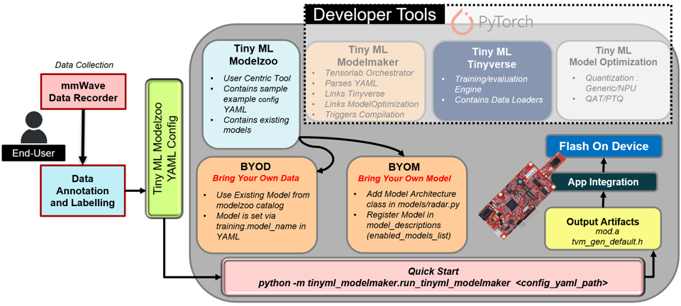

# Radar Surface Classification
### -Atharv Vats, Adithya Thonse

Classify the surface or material underneath/in front of a TI mmWave radar sensor — e.g. floor type, terrain, or ground material — directly from **1-D FFT range-profile data**, with no point cloud or tracker involved. The shape of the energy return across range bins *is* the feature, because different materials reflect radar energy differently at different distances.

This guide covers the data pre-processing configuration, training, quantization, and compilation for the xWRL6432 target using Tensorlab EdgeAI - TinyML Modelzoo needed for re-training.

Modelzoo provides a modular CLI approach to add new models/ modify existing model architectures, providing BYOD, BYOM approach from re-training perspective.

- **Example config:** [config.yaml](./config.yaml)
- **Sample Dataset:** [radar_grass_surface_dataset.zip](https://software-dl.ti.com/C2000/esd/mcu_ai/datasets/radar_grass_surface_dataset.zip) (Grass vs Not Grass)

---

## Index

- [Overview](#overview)
- [Quick Start](#quick-start)
  - [Prerequisites Checklist](#prerequisites-checklist)
  - [Linux / macOS — Install (Recommended)](#linux--macos--install-recommended)
  - [Windows (PowerShell) — Install (Recommended)](#windows-powershell--install-recommended)
  - [Quick Commands (After Install)](#quick-commands-after-install)
  - [Bring Your Own Data (BYOD) / Bring Your Own Model (BYOM)](#bring-your-own-data-byod--bring-your-own-model-byom)
  - [Output Structure](#output-structure)
- [YAML Configuration for Surface Classification](#yaml-configuration-for-surface-classification)
  - [Expected Column Mapping](#expected-column-mapping)
  - [Dataset Split Methods](#dataset-split-methods)
  - [Data Pre-Processing and Feature Extraction Presets](#data-pre-processing-and-feature-extraction-presets)
  - [`data_processing_feature_extraction` YAML block generation](#data_processing_feature_extraction-yaml-block-generation)
- [Model Architecture](#model-architecture)
- [Output Tensor](#output-tensor)
- [Quantization](#quantization)
- [Compilation](#compilation)
- [Key Reference Files](#key-reference-files)
- [Need More Help?](#need-more-help)

---

## Overview

This example demonstrates using TI mmWave sensors with machine learning for surface/material classification using the xWRL6432 sensor. The application classifies surface types such as:

- **Grass vs Not Grass** 
- **Wet vs Dry** 

The model uses the radar's on-device signal chain output — the FFT range profile (`bin0`...`binN` columns) — as input. No point cloud or track data is required.

### Retraining Workflow



---

## Quick Start

### Prerequisites Checklist

| Requirement | Version | Notes |
|-------------|---------|-------|
| Python | 3.10.x | **Required** for ti_mcu_nnc compiler wheel |
| Git | Latest | With core.longpaths=true |
| Virtualenv | Built-in | python -m venv |
| TI ARM Compiler | 5.1.1.LTS | For compilation only; set TI_CGT_ARMLLVM_PATH |
| CUDA (optional) | 11.8+ | For GPU training; CPU works fine |

### Linux / macOS — Install (Recommended)

```bash
# 1. Enable long paths (required for some model files)
git config --global core.longpaths true

# 2. Clone and enter repo
git clone https://github.com/TexasInstruments/tinyml-modelzoo.git
cd tinyml-modelzoo

# 3. Create virtual environment & install (pulls modelmaker, tinyverse, torchmodelopt, ti_mcu_nnc as wheels)
python3.10 -m venv venv
source venv/bin/activate
python -m pip install --upgrade pip setuptools wheel
pip install -e .

# 4. Verify installation
python -c "import tinyml_modelmaker, tinyml_tinyverse, tinyml_torchmodelopt, tinyml_modelzoo; print('All packages OK')"

# 5. Set compiler for xWRL6432 (required for compilation step)
export TI_CGT_ARMLLVM_PATH=/path/to/ti-cgt-armllvm_5.1.1.LTS  # Adjust path

# 6. Run training (outputs to ./data/projects/)
./run_tinyml_modelzoo.sh examples/radar_surface_classification/config.yaml
```

---

### Windows (PowerShell) — Install (Recommended)

```powershell
# 1. Enable long paths (run once as Administrator)
git config --global core.longpaths true

# 2. Clone and enter repo
git clone https://github.com/TexasInstruments/tinyml-modelzoo.git
cd tinyml-modelzoo

# 3. Create virtual environment & install
python -m venv venv
.\venv\Scripts\Activate.ps1
python -m pip install --upgrade pip setuptools wheel
pip install -e .

# 4. Verify installation
python -c "import tinyml_modelmaker, tinyml_tinyverse, tinyml_torchmodelopt, tinyml_modelzoo; print('All packages OK')"

# 5. Set compiler for xWRL6432 (required for compilation step)
#$env:TI_CGT_ARMLLVM_PATH = "C:\path\to\ti-cgt-armllvm_5.1.1.LTS"  # Adjust path

# 6. Run training (outputs to .\data\projects\)
# If script blocked: Set-ExecutionPolicy -ExecutionPolicy RemoteSigned -Scope CurrentUser
./run_tinyml_modelzoo.ps1 examples/radar_surface_classification/config.yaml
```

---

### Quick Commands (After Install)

| Action | Linux/macOS | Windows (PowerShell) |
|--------|-------------|----------------------|
| **Activate venv** | source venv/bin/activate | .\venv\Scripts\Activate.ps1 |
| **Run training** | ./run_tinyml_modelzoo.sh examples/radar_surface_classification/config.yaml | ./run_tinyml_modelzoo.ps1 examples/radar_surface_classification/config.yaml |

---

### Bring Your Own Data (BYOD) / Bring Your Own Model (BYOM)

#### **BYOD: Use Your Own Radar Data**

1. **Organize data by class** (required for amongst_files split):
   ```
   my_dataset/
   ├── classes/
   │   ├── grass/
   │   │   ├── grass_001.csv
   │   │   └── grass_002.csv
   │   └── not_grass/
   │       ├── not_grass_001.csv
   │       └── ...
   ```

2. **Update config.yaml** — point to your data:
   ```yaml
   dataset:
     dataset_name: "my_custom_surface"
     input_data_path: ""  # Empty = no auto-download
     split_type: "amongst_files"
     split_factor: [0.7, 0.2, 0.1]
   ```

3. **Ensure column names match** bin0, bin1, bin2... for range data

4. **Run training**:
   ```bash
   ./run_tinyml_modelzoo.sh examples/radar_surface_classification/config.yaml
   ```

#### **BYOM: Add Your Own Model**

1. **Edit** `tinyml_modelzoo/models/radar.py` and add your model class:
   ```python
   class MyCustomRadarModel(nn.Module):
       def __init__(self, config, input_features=130, variables=1, num_classes=2):
           super().__init__()
           self.config = config or {}
           self.input_features = self.config.get('input_features', input_features)
           self.variables = self.config.get('variables', variables)
           self.num_classes = self.config.get('num_classes', num_classes)
           
           input_size = self.input_features * self.variables
           
           # Your architecture here
           self.layers = nn.Sequential(
               nn.BatchNorm1d(input_size),
               nn.Linear(input_size, 64),
               nn.ReLU(),
               nn.BatchNorm1d(64),
               nn.Linear(64, num_classes)
           )
       
       def forward(self, x):
           x = x.view(x.size(0), -1)
           return self.layers(x)
   
   # Add to __all__ list at bottom of file:
   __all__ = [
       'RF_MLP_3L_11K', 'RF_MLP_4L_19K', 'RF_DualStream_PointCloud_19K',
       'MyCustomRadarModel'  # <-- Add here
   ]
   ```

2. **Register model metadata** in `tinyml_modelzoo/model_descriptions/classification.py`:
   - Add a new entry in the _model_descriptions dictionary 
   - Add the model key to enabled_models_list 
   
   ```python
   # In _model_descriptions dict (around line 1576):
   'MyCustomRadarModel': deep_update_dict(deepcopy(template_model_description), {
       'common': dict(
           generic_model=False,
           task_type=constants.TASK_TYPE_RADAR_SURFACE_CLASSIFICATION,
           task_category=constants.TASK_CATEGORY_RADAR_CLASSIFICATION,
           model_details='Custom radar model for surface classification'
       ),
       'training': dict(
           model_training_id='MyCustomRadarModel',  # Must match class name in radar.py!
           model_name='MyCustomRadarModel',
           quantization=TinyMLQuantizationVersion.QUANTIZATION_GENERIC,
           properties=[dict(type="group", dynamic=True, script="radarclassification.py",
                          name="preprocessing_group", label="Preprocessing Parameters", default=[])] + template_gui_model_properties,
           target_devices=[
               constants.TARGET_DEVICE_xWRL6432,
           ],
       ),
   }),
   
   # In enabled_models_list (line 1606), add:
   enabled_models_list = [
       ...
       'RF_MLP_3L_11K', 'RF_MLP_4L_19K', 'RF_DualStream_PointCloud_19K',
       'MyCustomRadarModel',  # <-- Add here
   ]
   ```

3. **Use in config**:
   ```yaml
   training:
     model_name: "MyCustomRadarModel"
   ```

4. **Reinstall**:
   ```bash
   pip install -e .
   ```

> **Developer install** (pip install -e .) picks up model changes instantly — no rebuild needed.

> **Note**: Model descriptions are Python dicts in classification.py. See existing radar entries (RF_MLP_3L_11K, RF_MLP_4L_19K, RF_DualStream_PointCloud_19K) as templates.


---

### Output Structure

After training completes, find artifacts at:

```
./data/projects/radar_point_cloud_classification/run/<RUN_ID>/
├── training/
│   ├── base/           # Float model (ONNX, checkpoint.pth)
│   └── quantization/   # Quantized model (ONNX, checkpoint.pth)
└── compilation/
    └── artifacts/      # C artifacts: tvmgen_default.h, mod.a
```

---

## YAML Configuration for Surface Classification


> **Radar Config Builder (Coming Soon)**
>
> In the next Tensorlab release, we will be having a Radar config builder tool to help in streamlined yaml generation.

### Expected Column Mapping 

If your data uses different column names, rename to Tensorlab's expected format:

| Data Type | Your Column Pattern | → Rename To |
|-----------|---------------------|-------------|
| **Range Data** | `range_bin_0`, `fft_bin_0`, `fft_0` | `bin0` |
| | `range_bin_1`, `fft_bin_1`, `fft_1` | `bin1` |
| | `range_bin_2`, `fft_bin_2`, `fft_2` | `bin2` |
| | ... | `bin3`, `bin4`... `binN` |

### Dataset Split Methods

| `split_type` | When to Use |
|--------------|-------------|
| `amongst_files` | Each recording = one surface class (default, recommended) |
| `within_files` | Single recording contains multiple surface segments |


### Data Pre-Processing and Feature Extraction Presets

```yaml
data_processing_feature_extraction:
  feature_extraction_name: "Generic_130Input_Radar_SurfaceClassification"
```

**What this preset configures:**
- **Range Data**: Keeps bins 6–31 (26 bins), drops near-field (0–5) and far-field noise (≥32)
- **Window**: 5 frames, stride 0.2 (1-frame overlap), no quality filtering
- **Output**: 26 bins/frame × 5 frames = **130 features** → matches `RF_MLP_4L_19K` and `RF_MLP_3L_11K`

### `data_processing_feature_extraction` YAML block generation


#### Option 1: Override Preset Parameters

```yaml
data_processing_feature_extraction:
  # Option 1: Start from preset and override specific parameters
  feature_extraction_name: "Generic_130Input_Radar_SurfaceClassification"
  
  # --- Common Overrides ---
  frame_size: 8                     # More temporal context (default: 5)
  stride_size: 0.5                  # Less overlap (default: 0.2)
  radar_range_bins_bounds: [4, 40]  # Wider range bin selection (default: [6, 31])
  
  # --- Feature Ordering ---
  # radar_feature_ordering: 'feature_major'  # Group by bin across frames
```
___

#### Option 2: Fully Inline (No Preset)
```yaml
data_processing_feature_extraction:
  # Option 2: Fully inline (no preset) — for complete customization
  data_proc_transforms:
    - "Radar Range Data"
    - "Simple Window"
  
  # Range Data
  radar_range_bins_bounds: [6, 31]  # Keep bins 6 through 31 inclusive
  
  # Window parameters
  frame_size: 5
  stride_size: 0.2
  radar_feature_ordering: 'frame_major'
```

#### Option 3: For Training Ready Data - This only supports Windowing

```yaml
data_processing_feature_extraction:
  feature_extraction_name: "Generic_Radar_SimpleWindowOnly"
  frame_size: 5           # Must match model input
  stride_size: 0.2
```
**When to Use This Preset**

| Scenario | Example |
|----------|---------|
| **Pre-featurized data** | You already extracted features/frame externally |
| **Only windowing needed** | Each row = one radar frame (set `frame_size: window size needed`) |

**How It Works**
- **Assumes** input CSV rows = individual frames
- **Applies only** windowing: stacks `frame_size` rows → 1 sample
- **Input features** = `num_columns_in_csv` × `frame_size`

---

## Model Architecture

| Model | Shape | Params | Description |
|-------|-------|--------|-------------|
| **`RF_MLP_4L_19K`** (default) | 4-layer MLP | ~19K | `BatchNorm → FC(64) → ReLU → BN → FC(32) → ReLU → BN → FC(16) → ReLU → BN → FC(num_classes)`. Default input: 248 features. With 130-feature preset, first layer adapts automatically. (Mainly used for Posture and Fall Detection Application) |
| **`RF_MLP_3L_11K`** | 3-layer MLP | ~11K | `BatchNorm → FC(64) → ReLU → BN → FC(32) → ReLU → BN → FC(num_classes)`. Smaller footprint, faster inference. Default input: 130 features — **matches preset exactly**. |

Both models:
- Support quantization (QAT, 8-bit) and compilation for xWRL6432
---

## Output Tensor

- **X**: `[N_windows, 130]` = 5 frames × 26 range bins (`frame_major` order) (Considering frame_size as 5 and number of range bins as 26)
- **Y**: `[N_windows]` integer class index — one per surface

---

## Quantization

By default, generic quantization run is disabled. To enable:

```yaml
training:
  quantization: 1
```

**Quantization config (default):**
- Method: QAT (Quantization Aware Training) or PTQ (Post Training Quantization)
- Weight bitwidth: 8-bit
- Activation bitwidth: 8-bit

---

## Compilation

The ONNX model is compiled with **TVM + TI MCU NNC** backend into C artifacts for xWRL6432 (Cortex-M4):

```
compilation/artifacts/
├── tvmgen_default.h   # I/O structs, tvmgen_default_run() entry point
└── mod.a              # Precompiled static library
```

Firmware links `mod.a` and calls `tvmgen_default_run()`, feeding the 130-value flattened range-bin feature vector. The same range-bin-selection + windowing logic must be replicated on-device from the live FFT output.

---

## Key Reference Files

| Component | Location |
|-----------|----------|
| Model architectures | `tinyml-modelzoo/tinyml_modelzoo/models/radar.py` → `RF_MLP_3L_11K`, `RF_MLP_4L_19K` |
| Radar Data Pre-Processing Pipeline (full reference) | `tinyml-modelzoo/docs/RADAR_PROCESSING_PIPELINE.md` |

---

## Need More Help?

- Search for issues or post questions on the [TI E2E Forum](https://e2e.ti.com/)
- Tensorlab Modelzoo documentation - [Tiny ML Modelzoo User Guide](https://software-dl.ti.com/C2000/esd/mcu_ai/user_guide/index.html)

---

*Generated for Tensorlab EdgeAI — Texas Instruments*  
*Compatible with TI mmWave radar sensors*